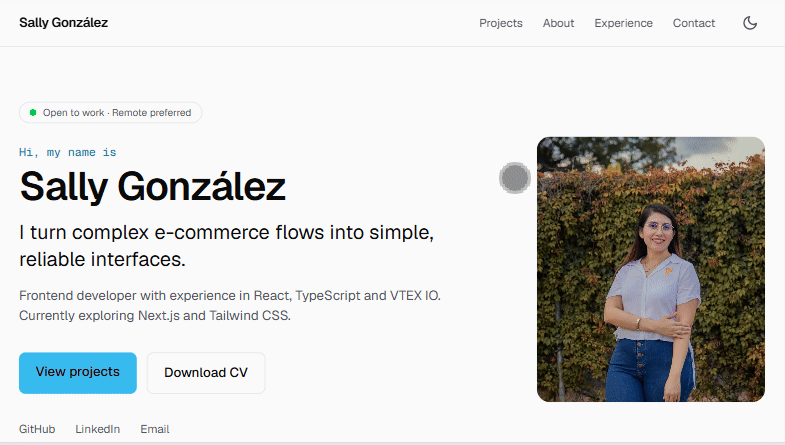

# Sally González | Portfolio


Personal portfolio of a frontend developer, built with **Next.js**, **TypeScript** and **Tailwind CSS**.

**Live site:** [portfolio-sallygongar](https://portfolio-sallygongar.vercel.app)



## What's inside

- **Hero** with an introduction, an open-to-work badge, a CV download and social links.
- **Projects** with a demo recording, stack tags and links for each one.
- **About and skills**, grouped by type, with a marker for what I am still learning.
- **Experience** timeline and education.
- **Contact** card with email, LinkedIn and GitHub.
- **Light and dark theme** that follows the system preference and remembers the visitor's choice.

## Tech stack

|               |                                                       |
| :------------ | :---------------------------------------------------- |
| **Framework** | [Next.js](https://nextjs.org/) 16 (App Router)        |
| **Language**  | TypeScript                                            |
| **Styling**   | [Tailwind CSS](https://tailwindcss.com/) v4           |
| **Fonts**     | Geist and Geist Mono through `next/font`              |
| **Linting**   | ESLint                                                |
| **CI**        | GitHub Actions (lint and build on every pull request) |
| **Hosting**   | Vercel                                                |

## Design and engineering decisions

- **Design tokens as CSS variables.** Colors are defined once in `globals.css` and mapped to Tailwind with `@theme`, so components use names like `bg-accent` or `text-muted` and never a hex value. Changing the accent color is a two-line edit.
- **Theme without a flash.** The theme lives in a `data-theme` attribute on `<html>`. A small inline script sets it before the first paint, using the saved choice or falling back to the system preference. The toggle needs no state: both icons are always in the HTML and CSS decides which one to show.
- **Server Components by default.** Only the theme toggle is a Client Component, so the rest of the page is sent as plain HTML. The site is generated at build time and served as static files.
- **Content in typed data files.** Site info, projects, skills and experience live in `src/lib`, separated from the components, so adding a project means adding an object to a list.
- **Images.** The portrait is imported statically and served through `next/image`. The project recordings are GIFs, so they are served as they are.
- **Accessibility.** Semantic landmarks and a heading hierarchy, a skip link, a visible keyboard focus, text for links that open in a new tab, decorative elements hidden from screen readers, and reduced motion respected.

## Getting started

Requires **Node.js 20.9 or higher**.

```bash
git clone https://github.com/sallygongar/portfolio.git
cd portfolio
npm install
npm run dev
```

Open [http://localhost:3000](http://localhost:3000).

### Scripts

| Command         | What it does                   |
| :-------------- | :----------------------------- |
| `npm run dev`   | Starts the development server  |
| `npm run build` | Builds the site for production |
| `npm run start` | Serves the production build    |
| `npm run lint`  | Runs ESLint                    |

## Project structure

```text
public/
├── projects/            # Demo recordings of each project
└── sally-gonzalez-cv.pdf
src/
├── app/                 # Layout, home page and global styles
├── assets/              # Images imported by components
├── components/          # Header, Hero, sections, project card, theme toggle
└── lib/                 # Typed data: site, projects, about and experience
```

## Roadmap

- [x] Responsive layout with light and dark themes
- [x] Header with navigation and a theme toggle
- [x] Projects, about, experience and contact sections
- [x] Continuous integration with GitHub Actions
- [ ] Case study pages for each project (dynamic routes and MDX)
- [ ] SEO metadata, Open Graph image, sitemap and robots
- [ ] Custom illustrated avatar and a new accent color
- [ ] Lighthouse scores published here

## Related repositories

The projects shown on the site live in
[react-advanced-apps](https://github.com/sallygongar/react-advanced-apps).

## License

Distributed under the MIT License.
